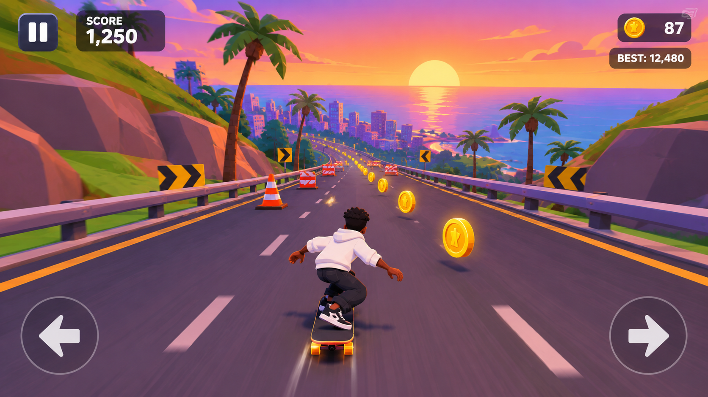

# Downhill Rush

An endless 3D downhill skateboarding game set on a coastal road at sunset. Built with React, TypeScript, Vite, Three.js and React Three Fiber.



## Run it

```bash
npm install
npm run dev        # http://localhost:5173
```

Production build:

```bash
npm run build      # type-checks, then bundles into dist/
npm run preview    # serves dist/ on http://localhost:4173
```

## Controls

| Action | Keyboard | Touch |
| --- | --- | --- |
| Steer | `A` / `D` or `←` / `→` (hold) | Hold the arrow buttons |
| Jump | `Space` / `↑` | JUMP |
| Slide (duck under barriers; in the air = fast drop) | `S` / `↓` | SLIDE |
| Trick (kickflip from the ground, 360 / kickflip in the air) | `X` | TRICK |
| Pause / resume | `Esc` | Pause button |
| Start / retry | `Enter` | PLAY / RETRY |

Avoid cones, barricades, rocks, "ROAD CLOSED" roadblocks and fallen palm logs. Jump over road gaps, and slide under the "DUCK" gates. Collect coins, and land air tricks for bonus points (several tricks in one jump stack as a combo). Three power-ups appear along the road, each with a countdown in the HUD (top right):

- **Shield** (cyan): absorbs one crash (9 s).
- **Magnet** (red horseshoe): pulls nearby coins from every lane toward you (10 s).
- **Speed Boost** (amber bolt): about 30% more downhill speed, with a light trail from the trucks (6 s).

Power-ups end on a wipeout, and every new run starts without any.

Best score and total coins are saved in `localStorage`. On the start screen you can switch between **High** and **Low** graphics and toggle sound. Low is picked automatically on touch devices and machines with 4 or fewer CPU cores.

## How it works

Everything is generated at runtime. There are no external models, textures or audio files, so nothing can fail to load.

```
src/
  game/                 pure game logic (no React)
    config.ts           tuning constants (lanes, physics, speeds)
    track.ts            endless procedural centre line: analytic heading + always-downhill elevation
    runtime.ts          mutable per-frame state + pooled obstacles/coins/power-ups
    sim.ts              simulation step: physics, tricks, collisions, scoring, run lifecycle, UI actions
    spawner.ts          pattern-based obstacle/coin generation with fairness rules
    input.ts            keyboard + touch input with buffered actions
    audio.ts            procedural Web Audio sound effects (created after the first user gesture)
    particles.ts        pooled particle simulation
    store.ts            zustand store for UI state (phase, score, best, settings)
    storage.ts          safe localStorage helpers
  scene/                React Three Fiber rendering
    world/              streamed road, guard rails, low-poly terrain, palms, rocks, chevron signs
    character/          rigged rider: loader, humanoid/IK helpers, authored skate clips, animator
    skater/             board rig (deck, trucks, wheels, shield) + Skater component
    ShaderWarmup.tsx    compiles shaders in parallel before the first frame
    Backdrop.tsx        sky/ocean dome shader, coastal valley, city skyline, islands
    Actors.tsx          obstacles, coins, shield power-ups, particles, speed lines
    CameraRig.tsx       third-person chase camera
    Lighting.tsx        sun/fill lights, follow-the-player shadows, sky-based environment map
  ui/                   HUD, touch controls, start/pause/game-over screens
```

Key techniques:

- **Endless world.** The visible window (40 m behind to 600 m ahead) is rebuilt in place every 20 m. Fixed-size vertex buffers and instance pools are reused, so nothing is allocated as you ride. Geometry is stored relative to a moving anchor so float precision stays good on very long runs.
- **Track space.** The player, obstacles and coins live in `(distance, lateral, height)` coordinates on the procedural road. That keeps collisions simple and exact. Physics uses delta time with fixed sub-steps so fast frames can't tunnel through obstacles.
- **Fair generation.** Obstacle rows are spaced in *time* (scaled by current speed), and every row leaves a free lane, a jumpable obstacle or a slide gap. Coins are never placed inside an obstacle.
- **Rigged rider.** `public/models/skater.glb` is a skinned humanoid (65-bone skeleton with fingers) built from CC0 Quaternius assets, with a hoodie, trousers and sneakers generated from the body surface (see below).
- **Skeletal animation.** The rider is driven by `THREE.AnimationMixer`:
  - Base clips (ride loop, air, slide, ollie, kickflip, 360) cross-fade by state.
  - Additive clips (toeside/heelside lean, landing crouch) layer on top.
  - The retargeted Quaternius `Death01` clip plays the wipeout.
  - A two-bone IK pass then plants both sneakers on the deck, so turning, landings, ollies and slides never leave floating or sliding feet.
  - One-shot clips are scrubbed in lockstep with the simulation, so pausing freezes the pose exactly.
- **Performance.** Instanced meshes, shared materials, adaptive pixel ratio (drei `PerformanceMonitor`), and a Low preset (no MSAA, no environment map, fewer shadow casters and props). Shaders compile in parallel (`renderer.compileAsync`) so the page doesn't freeze while they build.

## The skater asset pipeline

```bash
npm run build:skater   # rebuilds public/models/skater.glb from assets-src/
```

Source assets live in `assets-src/quaternius/` (all CC0 1.0 by [Quaternius](https://quaternius.com)):

- **Universal Base Characters (Standard).** Supplies the body, eyes, eyebrows and rig, plus the "Buzzed" hairstyle.
- **Universal Animation Library (Standard).** Supplies the wipeout clip.
- **Web textures.** `tools/skater/resize-textures.ps1` (Windows' built-in System.Drawing) downscales the 2K textures into `textures-web/`.

`tools/skater/build-skater.mjs` does the following (no third-party dependencies):

1. Welds the body mesh.
2. Generates the clothing (`garments.mjs`):
   - Cuts each garment from the body along clean hem, cuff and collar lines.
   - Subdivides it and applies Taubin smoothing, which removes muscle definition the way fabric does.
   - Adds ease, front/back drape, folds, rib bands and a rolled hood.
   - Keeps the body's skin weights.
3. Culls the skin hidden under the clothes.
4. Re-skins the hair to the head bone.
5. Retargets the wipeout clip (`retarget.mjs`).
6. Writes one self-contained GLB with embedded textures (`gltf-io.mjs`).

Credits are in `public/models/CREDITS.txt`. Dev-only inspection pages: `/?lab` (model + clips) and `/?lab&rig&state=ride|leanL|leanR|jump|slide|kickflip|spin|crash&view=back|side|front|game`.
- **Performance.** Instanced meshes, shared materials, adaptive pixel ratio (drei `PerformanceMonitor`), and a Low preset (no MSAA, no environment map, fewer shadow casters and props).
